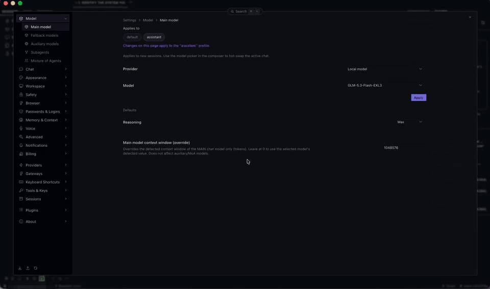

# Hermes Tether

**One Hermes agent, many machines.** Hermes Tether is a Hermes plugin that lends one remote Hermes agent the
local capabilities of your paired desktop machines: their terminal, their files, their screen and apps. The
agent keeps living on its own host (its memory, skills and conversations stay there); when you say
`tether <machine>`, its hands move to that machine, under that machine's own Hermes rules, until you send
`untether` as a message on its own.

**The gap it fills.** Hermes already lets you run your agent on a remote host and talk to it from Hermes
Desktop on your own machine, through a remote gateway (URL + login) or an SSH gateway. But the agent's
hands stay on that host: it cannot open an app, read a file or drive the screen of the machine you are
sitting at. Tether fixes that one thing. You keep connecting to your remote Hermes exactly as before
(remote server or SSH); Tether adds a separate, pinned, encrypted link from your machine's own Hermes to
the host, so the agent can work on your machine when you allow it, under that machine's own Hermes rules.
No new permission system: each machine's Hermes decides what is allowed on it.

## Demo



The same demo as a video file: [tether-demo.mp4](docs/media/tether-demo.mp4) (63 s, download to play).

What it shows, on a host (Linux) with one paired Mac:

1. The agent identifies where it runs: `Linux …`, the host.
2. It asks to be tethered. Nothing opens until the user types the exact words `tether mac`.
3. The Mac opens a box on its own screen; its owner types the 6-digit code from the authenticator app on their
   phone. Approved.
4. The agent identifies the system again: `Darwin …`, now on the Mac.
5. It opens Bambu Studio on the Mac, brings Hermes to the front, goes back to Bambu Studio, and closes it.
6. It runs a command Hermes flags as dangerous (`mkdir … && rm -r …`). Hermes's own command gate handles it
   in the host session. In the demo the approval mode is **Smart**, so Hermes's smart reviewer approved it
   (with Manual mode the usual approval card appears instead).
7. It asks to be untethered. The user types `untether`; the Mac empties the session's workspace and the
   agent is back on the host: `Linux …`.

The **Tether** panel in the right sidebar shows the paired machine and logs every step live.

## How it works

```
                       Hermes Desktop on your machine
                                    │  chat: Hermes's own remote gateway or SSH gateway (unchanged)
                                    ▼
 Host (the agent's own Hermes)                           Device (your machine's own Hermes)
 ┌───────────────────────────────┐   Tether link         ┌──────────────────────────────┐
 │ sessions, memory, skills      │   TLS 1.3, 256-bit,   │ its own Hermes, its own rules│
 │ devices tool  ── "tether mac" │◄─────────────────────►│ code box on its screen       │
 │ terminal backend: tether      │   pinned certificates │ terminal / files / screen    │
 │ computer use:   tether_screen │                       │ per-session workspace        │
 └───────────────────────────────┘                       └──────────────────────────────┘
```

The chat route (how Desktop reaches the host) and the Tether link (how the host reaches your machine) are
independent: Tether works with either of Hermes's Desktop routes and changes neither.

**Verified with both Desktop routes** (Hermes 0.23.0):

| Desktop connected to the host by | Host | Result |
|---|---|---|
| Remote gateway (URL + sign-in) | Hermes in a Docker container on a home server | Tethered the Mac: terminal, apps, approval gate, untether, Tether panel |
| SSH gateway (Hermes started over SSH) | Hermes on a Linux workstation, as its own user | Tethered the Mac and opened an app on it; Tether panel live |

**Verified devices:** a Mac (macOS 26) and a Windows 11 PC, paired to the same host and online side by
side: one agent, two machines. On each, the agent ran commands, opened apps and read the screen. Both Desktops
share one backend, so closing either one ends the other's chat too (see [Limits](#limits)).

For the SSH route, connect as the user that owns the remote Hermes install: Hermes requires its session
token inside that user's own `~/.hermes`.

- **Pairing, once.** On the host, `hermes tether pair <name>` prints a one-time link (valid 10 minutes,
  single use, revoked after 3 bad proofs). On the device, `hermes tether join`, then paste the link at its
  prompt. The host's owner
  confirms. Each side then pins the other's certificate; the private keys are encrypted at rest with a
  passphrase kept in Hermes's own secret store. Tether keeps that passphrase out of the agent's shells and
  output; a command that sets out to read the machine's files can still read it (see
  [What it does not protect against](#security-model)).
- **The link.** Every boot the device dials the host and both sides check the pinned fingerprints before
  any data moves (TLS 1.3 only, 256-bit suites). The host only accepts paired devices. A device that is
  asleep or not running Hermes simply shows as offline.
- **Each machine introduces itself.** On connect the device announces plain facts: its OS, version and the
  shell its Hermes runs commands with (bash; on Windows that is Git Bash). The host turns them into a short
  brief from its own fixed table and gives it to the agent when it tethers and on every turn while
  tethered (on Windows: write bash, use `/dev/null`, run slash-switch tools through `MSYS_NO_PATHCONV=1` or
  PowerShell, start apps with `Start-Process`). Before the person at a device allows a session, the agent sees only
  what the host checked: an OS, shell and architecture from fixed lists, and version numbers. A device's own words
  never reach it.
- **Only the user's words open a machine.** A connection opens only when a line of the user's own message starts
  with `tether <device>`; mentioning a machine ("open Bambu Studio on the mac", "please tether mac") is refused
  with a pointer to the phrase. Tool results, web pages, other agents' messages and the agent itself can never open
  or switch machines. In a mail only the first line of the body counts. With two paired names like `mac` and
  `mac-mini`, `tether mac mini` opens `mac-mini`, the longest name the line spells. `untether`
  closes it, and only as a message on its own: "untether mac" or "thanks, untether" does nothing.
- **Only your own turns reach the machine.** Hermes's own follow-up turns (a `/goal` or `/loop` step, a heartbeat,
  a background-job or sub-agent wake, a message from another agent) and scheduled jobs work on the host, even
  while a machine is open; your next message picks the work up on the machine again.
- **The person at the machine approves each session with a code.** The first use in a session opens a box on
  the device's screen (macOS: a system dialog with a hidden field; Windows: a small window on top of the others
  with a masked field) that names the host as it was paired and when, the session, and when the box closes. Type
  the 6-digit code from your authenticator app and press Return. Cancel, no code within the wait (60 s by
  default), or wrong codes close the connection and nothing runs. A click never approves, and nothing on the host
  can type into the box: whatever tricks the host can at most make the box appear. Each code works once. A grant
  ends after the idle limit, counted from the end of the last call (a command still running never times out this
  way); the next use asks again; a new chat always asks again. While the box is open nothing reaches the screen,
  screenshots included.
- **Device mode.** While tethered, the session works *on* the device: the terminal runs there, file tools
  run inside the device's own Hermes (its hooks, paths, file rules, write fence, credential protection),
  computer use drives its real screen. Each session starts in its own workspace folder on the device, which is
  emptied when the connection closes (on Windows too, including files a program still holds open, which
  are removed within a minute, and reserved names such as `nul`). Anything in it goes with it, including
  files the agent moved there; links in it are removed, never followed, and a file hard-linked into it keeps
  its mode.
- **Hermes's own approval rules, one gate per kind of action.** Nothing in Hermes's approval path is
  skipped: a terminal command meets Hermes's dangerous-command gate in the host session (its card,
  session/always answers, smart mode), scripts meet the execute_code gate, computer use its per-action
  cards, and a file call meets the host's own checks before it goes to the device (its plugins'
  `pre_tool_call` hooks, the compression-marker guard, the loop guardrails, ACP edit approval). The device
  then adds its own floors (hardline blocks, its own deny rules, its own hooks). A command meant for the
  device never runs on the host, even if the connection closes mid-call.
- **The host keeps its own work.** Memory, skills and the host's own Hermes home always stay on the host, except
  the device's session workspace folder inside it (`tether/sessions/`, or `profiles/<name>/tether/sessions/`
  for a device on a named Hermes profile), which is always the device's. A `~/...` path is the device's
  unless it walks into the host's Hermes home (`~/.hermes/...`); on a host whose home folder is its Hermes
  home (Hermes's Docker image) every `~/...` path is the device's. A large result of the host's own tools is
  never copied to the device.
  When a skill is opened while tethered, a read-only copy of its files is placed in the session workspace
  so its scripts can run on the device.

## The Tether panel

A **Tether** tab in the right sidebar (Hermes Desktop). Open it from the sidebar, the command palette
("Open Hermes Tether"), or **⌘⇧E** on macOS / **Ctrl+Shift+E** on Windows and Linux (rebindable in
Keybinds).

- **On a host:** each paired machine with its status, the exact words that open it, its OS, the link in
  use and its idle limit. Machines can be **renamed** (the label is the word that opens it, e.g.
  "Studio Mac" → `tether studio mac`) and given a **host idle limit**; the shorter of the host's and the
  machine's own limit applies, so the machine's own setting stays the ceiling.
- **On a device:** the settings that machine owns: its idle limit, how long the code box waits
  (20–600 s, 60 by default; `tether <device>` waits that long for the code, and a box never stays up
  after the host has stopped waiting), and **Pause**: it refuses all remote use and, within a second, stops
  what is already under way there (a running command, a screen action waiting its turn, an open code box)
  and ends every session; and **Run remote commands unlocked** (off by default on a Mac, where the session
  lock holds; on by default on a PC, which has no lock: off there refuses remote commands; the panel says what
  each choice means, and a change waits until no remote session is connected). The panel also shows whether the
  authenticator is on (it is set up only in a terminal at the device). Changes apply within seconds, no restart.
- **Connection log (both):** when machines connected or went offline, chats tethered and untethered,
  sessions allowed, denied or lapsed, workspaces emptied, settings changed. Times, labels and a short chat id
  only: never commands, paths, keys, addresses or a computer's own name.

The panel's desktop part ships switched off, like every Hermes plugin's. Turn it on from the plugin's page:
`hermes://open/capabilities?tab=plugins&plugin=tether` → **Desktop**.

## Setup

Requires Hermes **0.23.3** on both machines (the release this version is built and tested against), running on
Hermes's own Python 3.14 runtime as current Hermes installs do (Hermes's older 3.11 environments are only its update
bridge; Tether's tests pass on both). Install the
plugin folder `plugin/tether` (and `plugin/tether_screen` for computer use) into each Hermes's `plugins/` folder:
`~/.hermes/plugins/` on macOS and Linux, `%LOCALAPPDATA%\hermes\plugins\` on Windows.

On a device, Hermes must run in the signed-in desktop session (Hermes Desktop, or `hermes gateway run` in a
terminal there), not as a background service or over SSH: the code box needs a screen, and without one every
session is refused. Tether asks for no password at start and adds no keychain of its own: the authenticator's
secret is a sealed file in Tether's data folder, next to its key (see *Set up the authenticator*).

**Host** (`config.yaml`):

```yaml
terminal:
  backend: tether            # the agent's terminal follows the tether (host when untethered)
computer_use:
  backend: tether_screen     # computer use follows the tether
plugins:
  enabled: [tether]
  entries:
    tether:
      settings:
        role: host
        name: nas                       # how devices see this host
        listen: 192.0.2.10:9130         # a LAN or tailnet address; never internet-facing
```

**Device** (`config.yaml`):

```yaml
plugins:
  enabled: [tether]
  entries:
    tether:
      settings:
        role: device
        name: mac                       # the default label; the host can rename it
        grant_idle_minutes: 60          # the default; also editable in the panel on this machine
        consent_timeout_seconds: 60
        # allow_unlocked_commands: false   # default off on macOS, on on Windows; also in the panel (see The session lock)
```

**Pair:**

```bash
# on the host
hermes tether pair mac
# on the device: paste the link the host printed at the prompt
hermes tether join
```

The device's own `name:` setting must be the name you give `pair` (letter case does not matter); `local`, `host`
and `all` are reserved. If the device gives up before you answer `Pair it?`, nothing is paired and `pair` says so.

Other commands: `hermes tether status`, `hermes tether unpair <name>`, and on a device
`hermes tether pause` / `hermes tether resume` and `hermes tether authenticator setup | export [folder] |
join <file> | remove | recovery-codes | unlock`.

### Set up the authenticator

**One authenticator for all your machines.** Set it up once on the first machine, then add each other machine with
`hermes tether authenticator export` there and `hermes tether authenticator join` on the new one. Every machine
then asks, in a box on its own screen, for the 6-digit code from the same authenticator app entry, `Hermes Tether`
(1Password, Proton Pass, Google Authenticator, Microsoft Authenticator or any app that takes a setup key or a QR
code). A device without an authenticator refuses remote use, so after installing or updating to 0.3.0 set it up
once, on one machine, in about two minutes, and add the others as below. Do it yourself in a terminal there; it
refuses to run from an agent's or a remote session's shell, and it takes no code, phrase or key on the command
line. No system password, administrator or User Account Control dialog is involved: remote use is refused until the
first setup, so no remote session can exist to run it, and changing or removing it later needs a code from your app
or a recovery code, typed into a box on that screen.

**On the first machine (a Mac)**

1. Open Terminal on the Mac and run `hermes tether authenticator setup`. Remote use of the Mac is paused until
   setup ends.
2. Box *Set up the authenticator for remote use of this Mac*: make sure the screen is not shared or recorded, then
   click **Continue**.
3. Box *Add this key to your authenticator app*: it shows a QR code. Scan the QR code with the authenticator app
   on your phone (or, if your app cannot scan, type the key shown under the code). The entry is named
   `Hermes Tether`; keep the type time-based, 6 digits, 30 seconds. Click **I added it**.
4. Box *Enter the 6-digit code*: type the code the app shows for that entry and click **OK**.
5. Box *Recovery codes*: write down the ten codes or save them in your password manager, away from this Mac. Click
   **I saved them**. They are not shown again.
6. Click **OK** on the last box. The terminal says `The authenticator is set up.` No restart is needed: the running
   Hermes reads it within a few seconds.

**On the first machine (a Windows PC)**

1. Open PowerShell or Command Prompt normally (not *Run as administrator*) and run
   `hermes tether authenticator setup`.
2. Box *Set up the authenticator for remote use of this PC*: click **Continue**.
3. Steps 3 to 6 as on the Mac.

**Add another machine (Mac or PC)**

1. On a machine that already has the authenticator, run `hermes tether authenticator export`. It first asks for the
   current 6-digit code from your app, or one of your recovery codes: no code, no file. It then shows a one-time
   **transfer phrase** in a box. Write it down; the other machine asks for it, and it is not shown again.
2. It writes `tether-authenticator.transfer` in your Downloads folder (or in the folder you name on the command
   line) and prints only that path. The file holds the authenticator's secret sealed with the transfer phrase: it
   is readable only by you (0600), it is never overwritten, and neither the phrase nor a readable secret is in it.
   Carry the file to the other machine yourself (AirDrop, a USB stick, a shared folder), never through an agent.
3. On the other machine, in a terminal there, run `hermes tether authenticator join <path to the file>`. If that
   machine already has an authenticator, it first asks for that machine's current code or a recovery code, and
   joining replaces it. Type the transfer phrase in the hidden box (five tries, then it stops with nothing changed),
   then the 6-digit code your app shows for `Hermes Tether`.
4. The last box offers to delete the transfer file (**Delete** is the default). Delete it after joining, and destroy
   the written phrase. If the box could not delete it (it was a link or a folder, or this account may not remove it),
   it says so: delete it yourself, at that machine, and never through a link.

The transfer file is a one-time thing: make a new export every time you add a machine, and delete the file and the
phrase once that machine has joined. A recovery code works on every machine that holds the same fingerprints; each
machine records which codes it has used, so a recovery code used on one machine still works once on each of the
others.

Where it is kept: one file, `authenticator.json` in Tether's data folder (`~/.hermes/tether/`, next to
`identity.key.enc`), readable only by you (0600) and written in one step, so it is never half-saved. The secret in
it is sealed: on a Mac with Tether's key passphrase (the Hermes secret that also unlocks Tether's key), on Windows
with DPAPI for your Windows account; a copy of the file alone opens nothing. Beside it, `authenticator_state.json`
records which codes were used and how many wrong ones were typed, sealed so that a change or a deletion locks code
entry instead of resetting it.

**The key is kept the way Hermes keeps its own.** Hermes keeps its credential-vault key either in a 0600 file (the
default) or, when you set `vault.key_storage: keychain` in Hermes's config, in the OS keychain. Tether's 2FA key
follows that rule (D78): with `vault.key_storage: keychain` and a keychain that answers, the file above holds only
the name of a keychain entry (`Hermes Tether 2FA key`) and the secret itself lives in the OS keychain, written and
read exactly the way Hermes writes and reads its vault key there: the same keychain, the same read-back check, and
no password, no dialog and no sign-in that Hermes does not have. With the default setting nothing changes: the
secret stays sealed with Tether's key passphrase. The record says which of the two sealed it, so it is always
opened the way it was written; change Hermes's setting later and the record is re-sealed under the new one (the
seed never changes, and Tether's keychain entry goes when you leave that mode). If the keychain is set but does
not answer, Tether says so once and keeps sealing with Tether's key passphrase. When Hermes keeps its vault key in
the keychain, Tether's key is in the keychain too: if that keychain entry (`Hermes Tether 2FA key`) is deleted, the
authenticator cannot be opened and is reset by hand at the machine (delete `authenticator.json` in Tether's data
folder, then run `hermes tether authenticator setup`), the same as losing Hermes's own vault key.

The key is shown as a QR code to scan, with the key as text under it for an app that cannot scan: the machine
draws the code itself (macOS: the system's Core Image QR generator; Windows: the `qrcode` package when it is
installed) and the code, the key and the box's script travel only into the box, never into a terminal, a log or a
file. The entry is `Hermes Tether` on every machine, since one authenticator is used for all of them.

**Later**

| You want to | Run on the device | It asks for |
|---|---|---|
| Add another machine to the same authenticator | `hermes tether authenticator export` on a machine that has it, then `hermes tether authenticator join <file>` on the new one | the current code or a recovery code here, then the transfer phrase and the app code there |
| Move to a new phone, or replace the key | `hermes tether authenticator setup` | the current code (or a recovery code), then the setup steps |
| Lost your phone (you have recovery codes) | `hermes tether authenticator setup` | one recovery code, then the setup steps |
| Lost your phone and your recovery codes | nothing Tether can check, so it changes nothing: delete `authenticator.json` in Tether's data folder yourself, at the machine (never from a remote session), then run `hermes tether authenticator setup` | the setup steps (**Lost both** in any box says the same) |
| Make new recovery codes | `hermes tether authenticator recovery-codes` | the current code or a recovery code |
| Take codes again after too many wrong ones | `hermes tether authenticator unlock` | a recovery code (a code from the app is not taken there) |
| Turn remote use of this machine off for good | `hermes tether authenticator remove` | the current code or a recovery code |
| See its state | `hermes tether status` | nothing; it never shows the key |

Replacing an authenticator (with a current code or with a recovery code) creates a new one: your other machines
still use the old one, so run `hermes tether authenticator export` on the replaced machine and `join` on each of the
others again.

If every code is refused, check the device's clock first: codes depend on it (macOS: System Settings > General >
Date & Time > *Set time and date automatically*; Windows: Settings > Time & language > Date & time > *Set time
automatically*). Wrong codes typed here count with those typed into the approval box: after 5 in a row code entry
pauses (5, 10, then 20 minutes) and after 20 it locks until `hermes tether authenticator unlock`; a recovery code
still works. A recovery code used on one machine still works once on each other machine that holds the same
fingerprints: each machine records its own used codes. Before you uninstall Tether from a device, run
`hermes tether authenticator remove`, then delete the entry from your app.

**When to restart.** Hermes loads plugins and their settings when its gateway starts, so:

| You did | Restart needed |
|---|---|
| Installed or updated the plugin, or changed `plugins.entries.tether` in `config.yaml` | `hermes gateway restart` on that machine |
| Paired a device for the first time | No: the host and the device pick it up within seconds |
| Re-paired a device that is already connected to another host | No: within about 5 seconds the device drops the old host, ends its sessions there and connects to the new one |
| Changed a label, idle limit, consent wait or Pause in the Tether panel | No: applied live |
| Installed or updated the panel (`desktop/plugin.js`) | Quit and reopen Hermes Desktop; the first time, turn the plugin's **Desktop** switch on |

## Using it

```text
tether mac                      → the Mac asks its owner for a code from their authenticator app; the agent now works on the Mac
… any task …                    → terminal, files, apps and screen on the Mac, under the Mac's rules
untether                        → back on the host; the Mac empties the session workspace
```

**`untether` is a solo command.** Send it as the whole message, with nothing before or after it (case and
a trailing `.` or `!` don't matter). A reply to another message, a forward or a message with an attachment
does not count: send it as a plain message of its own. In a mail, put it on the first line; whatever the mail
client quotes below it is ignored. A voice note's transcript does count. Inside a longer message ("ok untether", "untether mac", "thanks,
untether") it does nothing and the agent stays on the machine; it will tell you to send `untether` on its
own. "Close the connection" or "go home" don't close it either.

The agent can list machines and their status with its `devices` tool at any time.

**First connection: name the plugin.** Hermes keeps many tools out of view until the agent searches for
them, so the first time, say it in full, with `tether mac` at the start of a line of its own:

```text
Use plugin Hermes Tether.
tether mac
```

**Then have the agent create a skill for the plugin**, so the short commands work on every device:

```text
Create a skill for the Hermes Tether plugin so that "tether <device>" and "untether" always call it.
```

With the skill in place, `tether <device>` and `untether` are enough on their own (`untether` only as the
whole message). The plugin does not
create this skill; the agent does, with its own skill tools on the host. The connection only opens when a line of your own message starts with `tether <device>`.

## Security model

| Threat | What stops it |
|---|---|
| Someone else's machine joins | Pairing needs a one-time link the host owner made and confirmed; only pinned certificates connect afterwards. |
| Traffic on the network | TLS 1.3 with 256-bit suites, both sides verify the pinned fingerprint before any data. |
| The agent (or a prompt injection) opens a machine | Only a line the user typed that starts with `tether <device>`, in a turn the user started, opens one, and it opens the longest paired name that line spells. Tool results, pages, quoted replies, forwarded mail (in a mail only the first line counts), attachments, link previews, other agents' messages, Hermes's own follow-up turns, scheduled jobs, sub-agents, webhook runs and third-party integrations (`--source tool`) cannot. |
| Another program on the host rides an open session | The device hands its approval to the one caller that asked for it (a grant token kept only in that Hermes process's memory). Any other caller, a second Hermes process included, makes the device show its code box again. The token is only ever sent to the machine key that issued it: editing the pairings so that the device's name points at another key gets that key nothing, on any close path. A look-alike session id (other letter case, or the workspace folder's name) cannot open or empty a live session's workspace. |
| Remote use while nobody is at the machine | Each session needs a code from the person's authenticator app, typed into the box on the device itself (a click approves nothing, and the link carries no code); it lapses after the idle limit (enforced on the host between turns too, counting time the host was asleep; a command still running is not idle); Pause refuses everything and stops what is already running within a second. Hermes's own follow-up turns (`/goal`, `/loop`, heartbeats, wakes) and other agents' messages work on the host, so they never use the machine or keep its grant alive. |
| The agent changes Tether or Hermes on a device, or reads their secrets | The session lock (macOS): every command Tether runs for a remote session (the terminal, background jobs, `execute_code` scripts and everything they start) runs inside macOS's own sandbox, so it cannot change Tether's installed files, the device's Hermes (its home with every profile, its install and the Python it runs on, its plugins, its `hermes` launcher and launch agents) or read anything in Hermes's home but the session's own workspace and the runtimes on its PATH. Tether's file tools (read, write, patch, search) run inside the same sandbox, so macOS refuses them the same files however a path names them. Where the lock cannot be applied, the command is refused, never run unlocked, unless the person at the machine turned on `allow_unlocked_commands` in Tether's settings (off by default on macOS). See [The session lock](#the-session-lock-macos-devices). |
| Dangerous commands | Hermes's own command gate in the session, plus the device's own floors; a refusal is final and reported, never routed around. |
| Work landing on the wrong machine | A connection that is lost, timed out, refused, switched or re-paired, ended by a Hermes restart or exit, or left behind when Hermes gives the conversation a new session id, is said to the agent, and the work meant for that device (terminal and files alike) runs nowhere for the rest of the turn; it is never quietly done on the host instead. Sub-agents, `/bg` runs and a new conversation (`/new`) keep working on the host and never use up or release that refusal. Background jobs are checked and stopped on the machine they started on, whoever asks (the conversation, a sub-agent, a stop from the chat); a stop ends the whole job, and a stop that did not happen is reported as an error, never as done. A file call meant for a device never falls back to the host; `~` paths and the device's workspace are the device's by a fixed host rule. |
| Leftover access after use | `untether`, a deny, the idle limit, a switch to another device, a rename, a re-pair or a restart closes the session and empties its workspace. A session whose approval ends on the device itself (its idle limit, Pause, a re-pair) is ended there too, its terminal included; a session's terminal is never ended while its approval is live. Closing a session also stops its work still waiting to start. Unpairing or re-pairing a device cuts its live link within a few seconds (the host's pin watcher); the old key is then told nothing, and its own idle limit ends the grant and empties the workspace. |
| Cleanup reaching your own files | The workspace cleanup stays inside Tether's own sessions folder whatever a session did to it: a link (in place of the folder or inside it) is removed, never followed; a mounted volume is never entered; a hard-linked file keeps its mode, lock and ACL; a locked entry never stops a close, the sweeper or a device start. |
| Key theft by the agent | On a macOS device during a session, the lock keeps the key files, the pins, the authenticator records and Hermes's `.env` out of reach of the agent's commands and file tools. Elsewhere only partly: on the host, on a Windows device (whose commands run unlocked by default) and on a Mac where `allow_unlocked_commands` was turned on, a command that sets out to read the key files can (see below). The keys are encrypted at rest, and the passphrase does not show up by accident: it is taken out of every Hermes process's environment (on macOS and Linux also out of the copy the system keeps from start-up), no terminal the plugin makes gives it to a command, Hermes's own terminals lose it again at every tool call, and it is masked in tool output, by each device for its own value too. |
| Text from a device steering the agent | What a device says about itself is checked against what it can be: the agent sees an OS, shell and architecture from fixed lists and version numbers, never the words after a number; a home folder is used only when it has the usual shape. A device that refuses a connection is reported in the host's own words. |
| A device's secrets in the chat | A file attached from a device (`MEDIA:`) is checked on the host against Hermes's attachment denylist and the device's own Hermes home (on Windows `%LOCALAPPDATA%\hermes`; the session workspace inside it excepted) before it is fetched. |
| Someone turns on, replaces or removes a device's authenticator | Only at the device, through boxes on its screen. Turning it on needs no other proof: remote use is refused until then, so no remote session exists that could run it. Replacing or removing it needs the current code or a recovery code, typed into a box there; with neither, Tether changes nothing. On a Mac the session lock also keeps every session command from reading or writing Tether's data folder, so a session can neither copy the secret nor delete the authenticator to start over. No code or key is taken on the command line, from stdin, from a file or over the link; the key and the recovery codes appear only in a box, never in a terminal, log or file. While a setup runs, remote use is paused, so no session sees the box. The command refuses to run in a remote session's or an agent's shell. Recovery codes are kept only as fingerprints inside the sealed record with the key; they open these settings only and never approve remote use. |
| Something on the device clicking or typing (an accessibility app, the agent's own screen actions, someone at the machine without the phone) | Clicking approves nothing; typing needs the current code. Every screen action from every session is refused while the box is open, screenshots included, and an action already running is waited for first. Guesses: 3 per request; after every 5 wrong codes in a row code entry pauses (5, 10, then 20 minutes); after 20 it locks until you unlock it at the computer with a recovery code. |
| Replay of a code someone saw | Each 30-second code is accepted once, recorded on disk (sealed, so a program without the secret cannot reset it) before anything is granted; codes typed before Hermes restarted are never accepted after it. |
| Someone reads the authenticator's secret on a device | It is a sealed 0600 file in Tether's data folder (macOS: sealed with Tether's key passphrase, or with a key in the OS keychain when Hermes keeps its vault key there; Windows: DPAPI for your account); the running Hermes opens it without asking anything and keeps it in memory. On a Mac, during a session, the session lock keeps the agent's commands and file tools away from that folder and from Hermes's `.env`. It never appears in plain form in a file, log, the link or the host, and each device masks it in what it sends back. Outside a session, programs running as you can read it, as they can read anything of yours (see below). |
| Exposure | Binds only to the address you configure (LAN or tailnet); nothing internet-facing by default. |

### The session lock (macOS devices)

While a remote session is connected, every command Tether runs for it (the terminal, background jobs,
`execute_code` scripts and everything they start) runs inside macOS's own sandbox. Those commands cannot change
Tether's installed files, this machine's Hermes (its home folder with every profile, its install and the Python it
runs on, its plugins, its `hermes` launcher and its launch agents), and cannot read anything in Hermes's home:
Tether's key, pins and authenticator records, Hermes's `.env`, credentials and settings. The session's own workspace
is the one folder in Hermes's home they can use. Tether's file tools (read, write, patch and search) run inside the
same sandbox: each session gets a small helper, this machine's own Python running Hermes's own file tools under the
session's sandbox, so macOS refuses them the same files however a path names them (a link, `..` after a link,
another letter case, `/System/Volumes/Data/...`, another name for the same file), and a relative path resolves in
the session's folder. Everything else about a file call is as before: this machine's Hermes hooks, approvals and
file rules still see it first. The first file call of a session starts the helper (about a second); each call after
it adds well under a millisecond. Tether still checks the path first, to give the agent a plain refusal early. The
lock applies only to what Tether runs for
the remote session, and only while it runs: you, your own terminal and apps, and this machine's own Hermes agent can
change those files at any time. To have the agent improve Tether, let it change a copy of the project; you install
the copy. If the lock cannot be applied (the sandbox is missing, or a protected file also has a name outside those
folders), the command or file call is refused and the agent is told why; it never runs unlocked.

**Run remote commands unlocked** (`allow_unlocked_commands`, on the Tether panel of each Mac and PC, or in
`config.yaml`): off by default on a Mac, where the lock holds; turning it on there runs a session's commands without
the sandbox, so they can read and change Tether's and Hermes's own files, the authenticator's secret included (the
approval box then says so); file tools then run in Hermes's own process too, behind Tether's path check only. A change takes effect once no remote session is connected, so a session cannot unlock
itself.

What this changes in a session's own work: it cannot read or change the device's Hermes home other than its
workspace, so `hermes` commands run there fail, the agent cannot read that machine's own Hermes skills, memories or
logs (its skills come from the host anyway), and installing into Hermes's Python, adding Hermes plugins or editing
that machine's Hermes skills, memories or scheduled jobs is refused (do those yourself). Programs that start a macOS
sandbox of their own cannot do so inside the lock (macOS refuses a sandbox inside a sandbox): run Swift package builds
with `--disable-sandbox`, Bazel with `--spawn_strategy=local`, and browsers started from the terminal (Chrome,
Electron apps, Playwright or Puppeteer) with their no-sandbox option, or run them yourself. The lock also tries to
stop disk images being mounted (this was not tested with a real image). git (with your keychain credentials and ssh), Homebrew, Python venvs and pip, node and npm, compilers and
make, the docker command and network access work as before.

**What the session lock does not cover: the normal risks of computer use.** An allowed session acts as you. The lock
stops the commands Tether runs from changing or reading the protected files themselves; it does not stop the agent
from getting something else to do it, and none of the following is blocked:
- **Screen control.** With computer use the agent types and clicks as a person would, into Terminal, an editor,
  System Settings or Hermes's own window, and what it types there runs with your full rights, outside the lock.
- **Asking other programs to act.** AppleScript and Apple Events to other apps (`osascript`), `open`, `launchctl`,
  login items, `cron` and `at`, Docker (a container can mount and change any folder you can), `ssh` to this
  machine, and any other service that does the work in its own process.
- **This machine's own running Hermes**, doing something it is asked to (for example in a message it receives).
  Tether keeps session commands off Hermes's local sockets in its home folder, not off every way to reach it.
- **Anything left behind to run later.** Shell start-up files, login items, launch agents, scheduled tasks and git
  hooks run after the session, or in your own terminal, with your full rights and outside the lock, and can then
  change Tether's files too.
- **Everything else you can reach.** Your documents, projects, `~/.ssh`, browser data, login-keychain items that
  programs may read without asking, and the environment of your running programs (when Hermes starts its gateway
  itself it hands launchd its settings, `.env` values included, and launchd shows them to any of your programs) are
  readable and changeable by the session, as by any program you run.

On Windows there is no lock. `allow_unlocked_commands` is on by default there, so a remote session's commands run
with your full rights and can read and change Tether's and Hermes's files, the authenticator's secret included
(Tether's own file tools check the path first and refuse those files, but they run in Hermes's own process there:
a check of the path text, not a lock, so treat it as a courtesy, not a wall). Turn it off on that PC's Tether panel
to refuse remote commands there; file tools and computer use still work. Allow only sessions you just asked for, and Pause or close a session you no
longer need.

**What it does not protect against.** A program running as the host's own user can read Hermes's secrets and
start its own Hermes, or forge link messages with the host's key; the device's code box is then the gate: it
opens only with a code from your phone, so type one only for a session you just asked for. Such a program can also hold up your opens for a while (one box it provokes and you cancel blocks that session id for a
minute; a burst of its boxes blocks new opens for five minutes); it gains no access that way. A paired device runs
your commands and returns their output itself: a device you no longer trust should be unpaired. Once its person has
approved a session, the device's own words also reach the agent in what it returns (command output, file contents, the
path of a skill's copy in its workspace) and in its home folder's name, which the agent is told on every turn when it
is one plain word or two joined by `.`, `_` or `-`. In a shared chat, anyone who can message the agent can type
`tether <device>`; the person at the
device still decides. With Hermes's legacy `compression.in_place: false`, a session id that Hermes changes between
turns is matched to its connection through Hermes's conversation id; if Hermes cannot read the conversation's
lineage, the agent is not told and its next commands run on the host (with the host's own approvals), never on
the device. A conversation resumed more than seven days after the Hermes process that held its connection ended
is not told either. Pause and closing a session stop a screen action only before it reaches the screen
driver: one already inside the driver finishes, since the driver cannot cancel it. Pause is checked once a
second, so work can go on for up to that second after it is pressed. Anything the agent moves into its session
workspace is deleted with it when the session closes. A locked or ACL-protected file that also has another name
elsewhere (a hard link) is left in the workspace until you remove it, and a volume mounted inside a workspace
stays until it is unmounted (both are logged). On Windows the cleanup checks each name right before using it,
so a program racing it on purpose could still redirect it; on macOS and Linux it works inside folders held open.
Hermes does not mark every forward: a WhatsApp forward, and a Telegram forward that Hermes merges into one turn with
a comment sent just before it, reach the agent as plain text and count as your own words, like a paste (Discord and
Feishu forwards and a Telegram forward on its own, voice notes included, are recognised and refused). In a mail the
first line counts, so a mail whose first line is someone else's text (one forwarded as an attachment with nothing
typed above it and no "Fwd:" subject, or an HTML-only reply that starts with the quoted text) counts too. A Hermes
started from a classic-CLI agent's shell is not recognised as one (only gateway and TUI shells carry Hermes's
session marks). In each case the device's code box is still the gate: type a code only for a session you just
asked for.

**A program already running as the device's user is not stopped by the authenticator settings.** They need the
current code or a recovery code whichever way they are started, and they refuse the plain path from a remote
session's shell; but such a program can read, delete or replace Tether's own files (its code and the authenticator
included) like any other file of that user, so it could weaken later checks without going through these settings.
On a Mac the session lock keeps a session's commands from doing so; on Windows (no lock) a session you allowed runs
as you and can do the same: the authenticator stops anyone getting in without your code, not what a session you let
in chooses to do. Only start a setup when this screen is not shared or recorded: the key box can
be read by anyone who sees the screen, and by a program that may read the screen or other windows (screen
recording or accessibility permission).

**The code box, exactly.** A program on the host that has the host's key can make the box appear on your machine
under any session id it likes, including the id of a chat you are using; the box shows the host as you paired it
and when, which that program cannot change, but it cannot tell such a request from Hermes's own. Type a code only
when you yourself just asked Hermes to use this computer and the box appeared right after. Up to 8 boxes in 5
minutes can be made to appear by anyone who can make your host send requests; each one is dismissed with Cancel,
and Pause stops them all. Someone at your computer, or a program on it that can type, can try up to 20 wrong codes
before code entry locks; each try has about a 3 in a million chance; the lock lasts until you unlock it at the
computer. If your computer's clock is more than about 30 seconds off, codes are refused (set it to update
automatically); for up to a minute after Hermes starts on the device, codes are refused on purpose (so a code typed
before a restart can never be used again), and the box says so: wait for the next code in your app.

**The authenticator's secret on a device.** Tether keeps it in one sealed file in its data folder, next to its own
key, and asks for no password (Hermes itself has no such step, and Tether does not add one). It uses the OS
keychain only when Hermes keeps its own vault key there (`vault.key_storage: keychain`), and then the same
keychain, the same way and with no step of its own; Hermes's own *Who can get at the vault* table applies to it as
well (D78). On a Mac the file is sealed with Tether's key passphrase (or with a key in that keychain), and during a
remote session the session lock keeps the agent's commands and file tools from reading or changing it. On Windows it is sealed with DPAPI for your Windows
account: it cannot be opened from another account, a copied disk or a backup without your Windows password, and
since a Windows session's commands run unlocked by default, a session you approved can read it. Outside a session,
any program running as you can read it (the key passphrase is in Hermes's `.env`), and read it from Hermes's memory,
like anything else of yours: the normal risk of computer use and of malware on your machine. What no secret store
stops: a program running as you that sets out to do so, a session you
approved included, can change Tether itself or anything else you can change on that machine, and from then on
could approve sessions for you; the code protects the moment a session opens. If you think that happened: Pause
the device, reinstall the plugin, remove Tether's entry from your authenticator app and set up a new one. Keep the
authenticator on your phone: Hermes can make codes itself from 1Password, Bitwarden and its own vault, and any
program on a computer where such a manager is unlocked can ask it for a code, so do not add Tether's entry to a
password manager that the device or the host can open. On Windows, a crash
report of Hermes (Windows Error Reporting) can hold the secret, and a program running as you can read keystrokes
and so see a code as you type it (it works once, within about a minute).

**On the host, the keys can be read by anything running as that machine's user** (and on a device by anything running as its user outside a session; during a session the macOS lock keeps a session's commands away from them, unless `allow_unlocked_commands` was turned on, and on Windows, where commands run unlocked by default, it does not). Each machine's key
(`$HERMES_HOME/tether/identity.key.enc`) and its passphrase (in Hermes's `.env`, or your secret source) are that
user's files. Any program running as the user can read them: on the host, the agent's own terminal; on a
device, the host's agent during a session the person there allowed, as it can read every other file of that
user. Tether keeps the passphrase out of environments and plain output so it does not leak by accident; an
encoded copy (base64, hex, reversed) still gets through. On a gateway that serves several Hermes profiles,
Hermes's own local terminal (not Tether's) gets the names in that profile's `.env`, the passphrase included;
there it is masked in output but present in the environment. What a stolen key allows: whoever holds a
device's key and passphrase and can reach the host's address can connect as that device; while connected it
takes the device's place, receives what the host's agent sends to that device in sessions you open, and can
answer with false results, as a paired device turned hostile can. It cannot run anything on the real device or
on the host by itself, open a session, or reach another device. Whoever holds the host's key can pose as the
host only to a device that connects to them, and each session still needs a code typed into the box at that device. If a key
may have been read: on the host run `hermes tether unpair <device>`; on that device delete `identity.key.enc`
and `identity.crt` from `$HERMES_HOME/tether/` and restart its Hermes, which makes a new key; then pair again.
For the host's key, delete the same two files on the host, restart its Hermes and pair every device again.

**Updating from 0.2.** Update the host and every device together. After the update every device refuses remote
use until an authenticator is there: the agent says *mac did not allow remote use: no authenticator is set up
there yet*, and `hermes tether status` on the device says the same. There is no Yes/No box any more. Run
`hermes tether authenticator setup` once on one machine, then add the others with `export` and `join` ([Set up the
authenticator](#set-up-the-authenticator)); it asks for no password or administrator check. Pairings stay as they
are. A Mac now runs remote commands inside the session lock; a Windows PC runs them unlocked, as before (turn
**Run remote commands unlocked** off on its panel to refuse them). The normal risks of letting an agent use your
computer remain ([what the session lock does not cover](#the-session-lock-macos-devices)).

**Updating from 0.1.** Version 0.2 changes the link protocol (every call now carries the session's grant
token). Update the host and every device together; until both sides run 0.2, the link is refused with a message
that says so. See [CHANGELOG.md](CHANGELOG.md).

## Repository

```
plugin/tether/            the plugin (agent half + dashboard API + desktop panel)
  __init__.py             registration (inert until a role is set)
  tether/                 identity, pairing, TLS link, host/device services, consent, device rules,
                          terminal backend, devices tool, event log
  dashboard/plugin_api.py the Tether panel's backend (/api/plugins/tether/…)
  desktop/plugin.js       the Tether panel, command palette entry and shortcut
plugin/tether_screen/     computer-use provider that drives the paired machine's screen
tests/                    unit and loopback tests (two real Hermes services over TLS on localhost)
scripts/                  maintainers only, never shipped: the Hermes release watcher (scripts/README.md)
DESIGN.md                 the full design and every decision (D1–D77) with its reasoning
docs/WINDOWS-TESTING.md   the checklist used to validate a Windows device
docs/media/               the demo video
```

Run the tests with Hermes's own Python:

```bash
cd tests && ~/.hermes/hermes-agent/venv/bin/python -m unittest discover -s . -p "test_*.py"
```

`hermes plugins validate plugin/tether` passes (manifest, registrations, security scan, no core
overrides, desktop surface inside the plugin SDK). It lists the plugin's imports of Hermes internals as warnings
(such as the approval checks, the local terminal environment and the computer-use registry): there
is no public plugin API for these yet.

`plugin/tether_screen` is installed by hand next to `plugin/tether` (it is not the catalog entry). Its
validation stops at the capability probe (`register() raised: register_computer_use_provider`), exactly
as Hermes's own bundled computer-use plugin (`plugins/computer_use/cua`) does: the validator does not
probe computer-use providers yet. It loads and works in Hermes itself.

## Disclosure

Network: the host listens on the address you configure; each device dials the host. No third-party
services, no telemetry. Shell commands and file access on a device happen only while tethered, after its
owner approves the session with a code from their authenticator app. Background tasks: the link listener (host), the device's connection, an idle
sweeper and a settings watcher. Stored credentials: one Ed25519 key per machine, encrypted at rest; its
passphrase in Hermes's secret store; on each device, the authenticator's secret and its recovery codes'
fingerprints in one sealed file in Tether's data folder (macOS: sealed with that passphrase; Windows: DPAPI).

## Limits

- Desktop machines only; headless servers are better served by SSH.
- **Windows devices have no session lock.** Windows has no sandbox Tether can put around a session's commands, so
  they run unlocked by default (`allow_unlocked_commands` on), with your full rights; turn it off on that PC's
  Tether panel to refuse them. File tools and computer use work either way.
- **Devices: macOS and Windows.** On Linux the device refuses remote use: it has neither the code box nor a
  safe place for the authenticator's secret.
- **Host: macOS and Linux (POSIX) only.** The host's processes share one link through a file lock and a
  Unix socket, so a Windows machine can be a device but not a host; there the host role logs a warning and
  does not start. The Tether panel runs on all three.
- If the host's approval mode is Off or YOLO, Hermes answers its own approval card itself; the device's
  floors still apply.
- `execute_code` runs each script as one command on the machine the session is on (Hermes's per-call path).
  Hermes's persistent remote kernel is not used over tether, so variables and imports do not carry over from
  one `execute_code` call to the next. Each command a script runs is still judged by the device's rules.
- **Stopping a background job on a Windows device does nothing, and says so.** Tether cannot stop a job's
  whole process tree there, so Hermes reports the stop as an error and keeps tracking the job; stop it at the
  machine, or with a command of your own. On macOS and Linux a stop ends the whole job.
- `vision_analyze` and `video_analyze` expand `~` with the host's home before tether sees the path (Hermes
  does this itself); name a device's image by its absolute path.
- In an ACP (Zed) session, Hermes builds the edit-approval diff from the host's own files, as for any remote
  terminal backend: for a file on a device it shows the host's copy of that path, and a `patch` to a file the
  host does not have is denied.
- **Several Desktops on one backend share it.** When two machines (say a Mac and a Windows PC) each run
  Hermes Desktop against the same host, they are two windows on one backend, not two agents. Closing
  Hermes Desktop on one machine also ends the chat open on the other. This is how Hermes's single backend
  works; the plugin cannot change it. Tethering itself is unaffected: each chat tethers its own device.

## License

MIT (see [LICENSE](LICENSE)). Free to use, fork and integrate.

---

Built for the Nous Research Hermes hackathon (November 2026).

**Author:** James Reed. Developed with AI: designed, written and tested together with Claude (Anthropic).
