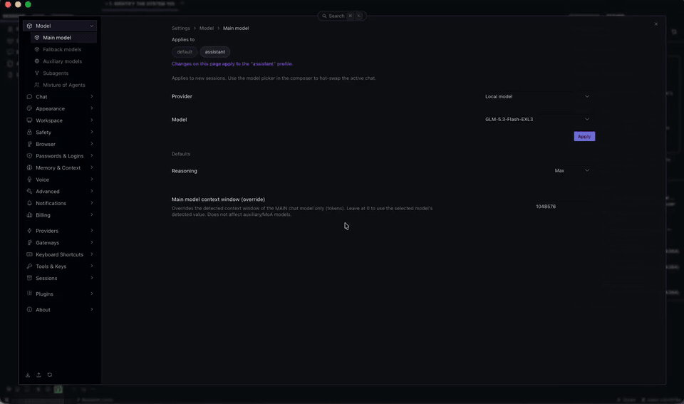

# Hermes Tether

**One Hermes agent, many machines.** Hermes Tether is a Hermes plugin that lends one remote Hermes agent the
local capabilities of your paired desktop machines: their terminal, their files, their screen and apps. The
agent keeps living on its own host (its memory, skills and conversations stay there); when you say
`tether <machine>`, its hands move to that machine, under that machine's own Hermes rules, until you send
`untether` as a message on its own.

**The gap it fills.** Hermes already lets you run your agent on a remote host and talk to it from Hermes
Desktop on your own machine, through a remote gateway (URL + login) or an SSH gateway. But the agent's
hands stay on that host: it cannot open an app, read a file or drive the screen of the machine you are
sitting at. Tether fixes that one thing. You keep connecting to your remote Hermes exactly as before
(remote server or SSH); Tether adds a separate, pinned, encrypted link from your machine's own Hermes to
the host, so the agent can work on your machine when you allow it, under that machine's own Hermes rules.
No new permission system: each machine's Hermes decides what is allowed on it.

## Demo



The same demo as a video file: [tether-demo.mp4](docs/media/tether-demo.mp4) (63 s, download to play).

What it shows, on a host (Linux) with one paired Mac:

1. The agent identifies where it runs: `Linux …`, the host.
2. It asks to be tethered. Nothing opens until the user types the exact words `tether mac`.
3. The Mac asks its owner to allow this session (on the Mac's own screen). Allowed.
4. The agent identifies the system again: `Darwin …`, now on the Mac.
5. It opens Bambu Studio on the Mac, brings Hermes to the front, goes back to Bambu Studio, and closes it.
6. It runs a command Hermes flags as dangerous (`mkdir … && rm -r …`). Hermes's own command gate handles it
   in the host session. In the demo the approval mode is **Smart**, so Hermes's smart reviewer approved it
   (with Manual mode the usual approval card appears instead).
7. It asks to be untethered. The user types `untether`; the Mac empties the session's workspace and the
   agent is back on the host: `Linux …`.

The **Tether** panel in the right sidebar shows the paired machine and logs every step live.

## How it works

```
                       Hermes Desktop on your machine
                                    │  chat: Hermes's own remote gateway or SSH gateway (unchanged)
                                    ▼
 Host (the agent's own Hermes)                           Device (your machine's own Hermes)
 ┌───────────────────────────────┐   Tether link         ┌──────────────────────────────┐
 │ sessions, memory, skills      │   TLS 1.3, 256-bit,   │ its own Hermes, its own rules│
 │ devices tool  ── "tether mac" │◄─────────────────────►│ consent prompt on its screen │
 │ terminal backend: tether      │   pinned certificates │ terminal / files / screen    │
 │ computer use:   tether_screen │                       │ per-session workspace        │
 └───────────────────────────────┘                       └──────────────────────────────┘
```

The chat route (how Desktop reaches the host) and the Tether link (how the host reaches your machine) are
independent: Tether works with either of Hermes's Desktop routes and changes neither.

**Verified with both Desktop routes** (Hermes 0.23.0):

| Desktop connected to the host by | Host | Result |
|---|---|---|
| Remote gateway (URL + sign-in) | Hermes in a Docker container on a home server | Tethered the Mac: terminal, apps, approval gate, untether, Tether panel |
| SSH gateway (Hermes started over SSH) | Hermes on a Linux workstation, as its own user | Tethered the Mac and opened an app on it; Tether panel live |

**Verified devices:** a Mac (macOS 26) and a Windows 11 PC, paired to the same host and online side by
side: one agent, two machines. On each, the agent ran commands, opened apps and read the screen. Both Desktops
share one backend, so closing either one ends the other's chat too (see [Limits](#limits)).

For the SSH route, connect as the user that owns the remote Hermes install: Hermes requires its session
token inside that user's own `~/.hermes`.

- **Pairing, once.** On the host, `hermes tether pair <name>` prints a one-time link (valid 10 minutes,
  single use, revoked after 3 bad proofs). On the device, `hermes tether join <link>`. The host's owner
  confirms. Each side then pins the other's certificate; the private keys are encrypted at rest with a
  passphrase kept in Hermes's own secret store, never readable by the agent.
- **The link.** Every boot the device dials the host and both sides check the pinned fingerprints before
  any data moves (TLS 1.3 only, 256-bit suites). The host only accepts paired devices. A device that is
  asleep or not running Hermes simply shows as offline.
- **Each machine introduces itself.** On connect the device announces plain facts: its OS, version and the
  shell its Hermes runs commands with (bash; on Windows that is Git Bash). The host turns them into a short
  brief from its own fixed table and gives it to the agent when it tethers and on every turn while
  tethered (on Windows: write bash, use `/dev/null`, run slash-switch tools through `MSYS_NO_PATHCONV=1` or
  PowerShell, start apps with `Start-Process`). A device never writes free text into the agent's prompt.
- **Only the user's words open a machine.** A connection opens only when the user's own message contains
  `tether <device>`; mentioning a machine ("open Bambu Studio on the mac") is refused with a pointer to the
  phrase. Tool results, web pages and the agent itself can never open or switch machines. `untether`
  closes it, and only as a message on its own: "untether mac" or "thanks, untether" does nothing.
- **The person at the machine allows each session.** The first use in a session shows an allow/deny
  prompt on the device's screen (macOS: a system dialog; Windows: a message box on top of other windows,
  default **No**). Deny, or no answer within the wait (15 s by default), closes the connection and nothing
  runs. A grant ends
  after the idle limit; the next use asks again; a new chat always asks again.
- **Device mode.** While tethered, the session works *on* the device: the terminal runs there, file tools
  run inside the device's own Hermes (its paths, file rules, write fence, credential protection), computer
  use drives its real screen. Each session starts in its own workspace folder on the device, which is
  emptied when the connection closes (on Windows too, including files a program still holds open, which
  are removed within a minute, and reserved names such as `nul`).
- **Hermes's own approval rules, one gate per kind of action.** Nothing in Hermes's approval path is
  skipped: a terminal command meets Hermes's dangerous-command gate in the host session (its card,
  session/always answers, smart mode), scripts meet the execute_code gate, computer use its per-action
  cards. The device then adds its own floors (hardline blocks, its own deny rules). A command meant for the
  device never runs on the host, even if the connection closes mid-call.
- **The host keeps its own work.** Memory, skills and the host's own Hermes home always stay on the host.
  When a skill is opened while tethered, a read-only copy of its files is placed in the session workspace
  so its scripts can run on the device.

## The Tether panel

A **Tether** tab in the right sidebar (Hermes Desktop). Open it from the sidebar, the command palette
("Open Hermes Tether"), or **⌘⇧E** on macOS / **Ctrl+Shift+E** on Windows and Linux (rebindable in
Keybinds).

- **On a host:** each paired machine with its status, the exact words that open it, its OS, the link in
  use and its idle limit. Machines can be **renamed** (the label is the word that opens it, e.g.
  "Studio Mac" → `tether studio mac`) and given a **host idle limit**; the shorter of the host's and the
  machine's own limit applies, so the machine's own setting stays the ceiling.
- **On a device:** the settings that machine owns: its idle limit, how long the consent prompt waits
  (5–600 s, 15 by default), and
  **Pause** (refuse all remote use now). Changes apply within seconds, no restart.
- **Connection log (both):** when machines connected or went offline, chats tethered and untethered,
  sessions allowed, denied or lapsed, workspaces emptied, settings changed. Times, labels and a short chat id
  only: never commands, paths, keys, addresses or a computer's own name.

The panel's desktop part ships switched off, like every Hermes plugin's. Turn it on from the plugin's page:
`hermes://open/capabilities?tab=plugins&plugin=tether` → **Desktop**.

## Setup

Requires Hermes **0.23.0** or newer on both machines. Install the plugin folder `plugin/tether` (and
`plugin/tether_screen` for computer use) into each Hermes's `plugins/` folder: `~/.hermes/plugins/` on
macOS and Linux, `%LOCALAPPDATA%\hermes\plugins\` on Windows.

On a device, Hermes must run in the signed-in desktop session (Hermes Desktop, or `hermes gateway run` in a
terminal there), not as a background service or over SSH: the consent prompt needs a screen, and without one every
session is denied.

**Host** (`config.yaml`):

```yaml
terminal:
  backend: tether            # the agent's terminal follows the tether (host when untethered)
computer_use:
  backend: tether_screen     # computer use follows the tether
plugins:
  enabled: [tether]
  entries:
    tether:
      settings:
        role: host
        name: nas                       # how devices see this host
        listen: 192.0.2.10:9130         # a LAN or tailnet address; never internet-facing
```

**Device** (`config.yaml`):

```yaml
plugins:
  enabled: [tether]
  entries:
    tether:
      settings:
        role: device
        name: mac                       # the default label; the host can rename it
        grant_idle_minutes: 60          # also editable in the panel on this machine
        consent_timeout_seconds: 15
```

**Pair:**

```bash
# on the host
hermes tether pair mac
# on the device, with the link the host printed
hermes tether join "tether://…"
```

Other commands: `hermes tether status`, `hermes tether unpair <name>`, and on a device
`hermes tether pause` / `hermes tether resume`.

**When to restart.** Hermes loads plugins and their settings when its gateway starts, so:

| You did | Restart needed |
|---|---|
| Installed or updated the plugin, or changed `plugins.entries.tether` in `config.yaml` | `hermes gateway restart` on that machine |
| Paired a device for the first time | No: the host and the device pick it up within seconds |
| Re-paired a device that is already connected to another host | No: within about 5 seconds the device drops the old host, ends its sessions there and connects to the new one |
| Changed a label, idle limit, consent wait or Pause in the Tether panel | No: applied live |
| Installed or updated the panel (`desktop/plugin.js`) | Quit and reopen Hermes Desktop; the first time, turn the plugin's **Desktop** switch on |

## Using it

```text
tether mac                      → the Mac asks its owner to allow this chat; the agent now works on the Mac
… any task …                    → terminal, files, apps and screen on the Mac, under the Mac's rules
untether                        → back on the host; the Mac empties the session workspace
```

**`untether` is a solo command.** Send it as the whole message, with nothing before or after it (case and
a trailing `.` or `!` don't matter). Inside a longer message ("ok untether", "untether mac", "thanks,
untether") it does nothing and the agent stays on the machine; it will tell you to send `untether` on its
own. "Close the connection" or "go home" don't close it either.

The agent can list machines and their status with its `devices` tool at any time.

**First connection: name the plugin.** Hermes keeps many tools out of view until the agent searches for
them, so the first time, say it in full:

```text
Use plugin Hermes Tether: tether mac
```

**Then have the agent create a skill for the plugin**, so the short commands work on every device:

```text
Create a skill for the Hermes Tether plugin so that "tether <device>" and "untether" always call it.
```

With the skill in place, `tether <device>` and `untether` are enough on their own (`untether` only as the
whole message). The plugin does not
create this skill; the agent does, with its own skill tools on the host. The connection only opens when your own message contains `tether <device>`.

## Security model

| Threat | What stops it |
|---|---|
| Someone else's machine joins | Pairing needs a one-time link the host owner made and confirmed; only pinned certificates connect afterwards. |
| Traffic on the network | TLS 1.3 with 256-bit suites, both sides verify the pinned fingerprint before any data. |
| The agent (or a prompt injection) opens a machine | Only the user's own message with `tether <device>` opens one; tool results and pages cannot. |
| Remote use while nobody is at the machine | Each session needs the allow click on the device itself; it lapses after the idle limit; Pause refuses everything. |
| Dangerous commands | Hermes's own command gate in the session, plus the device's own floors; a refusal is final and reported, never routed around. |
| Leftover access after use | `untether`, a deny, the idle limit or a restart closes the session and empties its workspace. |
| Key theft by the agent | Keys are encrypted at rest; the passphrase lives in Hermes's secret store, which the agent cannot read. |
| Exposure | Binds only to the address you configure (LAN or tailnet); nothing internet-facing by default. |

## Repository

```
plugin/tether/            the plugin (agent half + dashboard API + desktop panel)
  __init__.py             registration (inert until a role is set)
  tether/                 identity, pairing, TLS link, host/device services, consent, device rules,
                          terminal backend, devices tool, event log
  dashboard/plugin_api.py the Tether panel's backend (/api/plugins/tether/…)
  desktop/plugin.js       the Tether panel, command palette entry and shortcut
plugin/tether_screen/     computer-use provider that drives the paired machine's screen
tests/                    103 unit and loopback tests (two real Hermes services over TLS on localhost)
DESIGN.md                 the full design and every decision (D1–D32) with its reasoning
docs/WINDOWS-TESTING.md   the checklist used to validate a Windows device
docs/media/               the demo video
```

Run the tests with Hermes's own Python:

```bash
cd tests && ~/.hermes/hermes-agent/venv/bin/python -m unittest discover -s . -p "test_*.py"
```

`hermes plugins validate plugin/tether` passes (manifest, registrations, security scan, no core
overrides, desktop surface inside the plugin SDK). It lists 12 private core imports as warnings
(such as the approval checks, the local terminal environment and the computer-use registry): there
is no public plugin API for these yet.

`plugin/tether_screen` is installed by hand next to `plugin/tether` (it is not the catalog entry). Its
validation stops at the capability probe (`register() raised: register_computer_use_provider`), exactly
as Hermes's own bundled computer-use plugin (`plugins/computer_use/cua`) does: the validator does not
probe computer-use providers yet. It loads and works in Hermes itself.

## Disclosure

Network: the host listens on the address you configure; each device dials the host. No third-party
services, no telemetry. Shell commands and file access on a device happen only while tethered, after its
owner allows the session. Background tasks: the link listener (host), the device's connection, an idle
sweeper and a settings watcher. Stored credentials: one Ed25519 key per machine, encrypted at rest; its
passphrase in Hermes's secret store.

## Limits

- Desktop machines only; headless servers are better served by SSH.
- **Devices: macOS and Windows.** On Linux the device refuses remote use until its consent prompt is
  added (only the prompt is missing; the rest is portable).
- **Host: macOS and Linux (POSIX) only.** The host's processes share one link through a file lock and a
  Unix socket, so a Windows machine can be a device but not a host; there the host role logs a warning and
  does not start. The Tether panel runs on all three.
- If the host's approval mode is Off or YOLO, Hermes answers its own approval card itself; the device's
  floors still apply.
- `execute_code` scripts reach the device as one command; each command they run is still judged by the
  device's rules.
- **Several Desktops on one backend share it.** When two machines (say a Mac and a Windows PC) each run
  Hermes Desktop against the same host, they are two windows on one backend, not two agents. Closing
  Hermes Desktop on one machine also ends the chat open on the other. This is how Hermes's single backend
  works; the plugin cannot change it. Tethering itself is unaffected: each chat tethers its own device.

## License

MIT (see [LICENSE](LICENSE)). Free to use, fork and integrate.

---

Built for the Nous Research Hermes hackathon (November 2026).

**Author:** James Reed. Developed with AI: designed, written and tested together with Claude (Anthropic).
