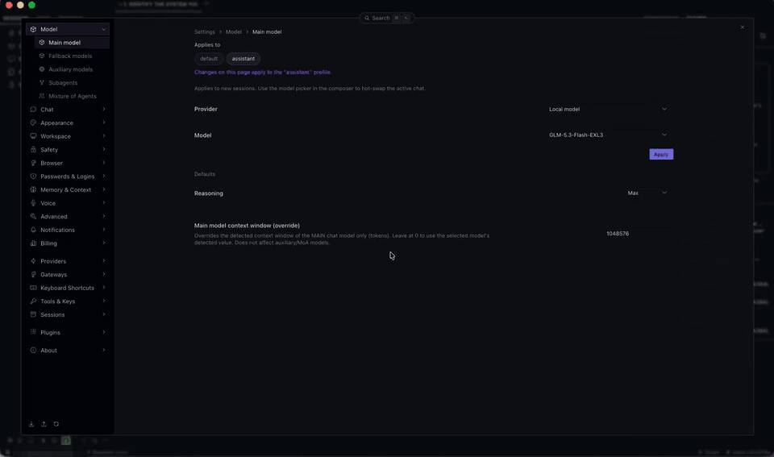

# Hermes Tether

**One Hermes agent, many machines.** Tether lends one remote Hermes agent the local capabilities of your
paired desktop machines (macOS and Windows): their terminal, their files, their screen and apps. The agent
keeps living on its own host; when you say `tether <machine>`, its hands move to that machine, under that
machine's own Hermes rules, until you send `untether` as a message on its own.



## Using it

```text
tether mac      → the Mac asks the person at it for a code from their authenticator app; the agent now works on the Mac
… any task …    → terminal, files, apps and screen on the Mac, under the Mac's rules
untether        → back on the host; the Mac empties the session workspace
```

- **Only your own words open a machine:** a line of your message must start with `tether <device>` as you typed it
  ("Tether mac and open Bambu Studio" opens; "please tether mac" does not). A reply quote, a forwarded mail, a
  chat forward Hermes marks, a file's note, a link preview, added context, another agent's message and a run that
  no person typed (a webhook, a schedule, a sub-agent, a `/goal` or `/loop` step, a third-party integration) do not
  count. In a mail only the first line counts. A voice note's transcript does, since it is what you said; an
  image's caption does too. Otherwise send `tether <device>` as a plain message of its own. With `mac` and
  `mac-mini` paired, `tether mac mini` opens `mac-mini`.
- **Only your own turns reach the machine:** Hermes's own follow-up turns (`/goal`, `/loop`, heartbeats,
  background-job wakes, other agents' messages) work on the host; your next message continues on the machine.
- **`untether` is a solo command:** send it as the whole message (in a mail, as its first line). Inside a longer
  message it does nothing. A reply, an attachment or a link preview does not count either (a voice note's
  transcript does).
- **The person at the machine approves each session** by typing the code from their authenticator app into a
  box on its own screen. The agent reports a connection only after that; Cancel, wrong codes, or no code within
  60 s means not connected. A click never approves, and nothing on the host can type into the box.

## Install

Requires a Hermes with the public plugin seams from [NousResearch/hermes-agent#160267](https://github.com/NousResearch/hermes-agent/pull/160267), [#160268](https://github.com/NousResearch/hermes-agent/pull/160268) and [#160269](https://github.com/NousResearch/hermes-agent/pull/160269) on the host and on each machine (until they are released, a Hermes built from those changes; without them Tether refuses remote use and says why). Install `tether` on both. For computer
use, also copy `plugin/tether_screen` from the repository into the same `plugins/` folder (it is installed
by hand, not from the catalog) and set `computer_use.backend: tether_screen` on the host. Set
`role: host` on the agent's Hermes and `role: device` on each machine, then pair once: `hermes tether pair
<name>` on the host, `hermes tether join` on the device (paste the link at its prompt). Then set up the
authenticator **once for all your machines**: on the first device run `hermes tether authenticator setup` yourself
and follow the boxes (about two minutes, with your phone): the box shows the key as a QR code to scan with the
authenticator app on your phone (the key as text under it, for an app that cannot scan), under the one entry name
`Hermes Tether`. Add each other machine with `hermes tether authenticator export` on a machine that has it (the
current code or a recovery code, then a one-time transfer phrase shown in a box only), carry the
`tether-authenticator.transfer` file to the new machine yourself, and run `hermes tether authenticator join <file>`
there (the transfer phrase, then the app's code; then delete the file). A device without an authenticator refuses
remote use (no password or administrator dialog, and no keychain step of its own). On a device, Hermes must run in
the signed-in desktop session, since the code box needs a screen.

When Hermes keeps its vault key in the OS keychain, Tether's 2FA key is in the keychain too: if that keychain entry
(`Hermes Tether 2FA key`) is deleted, the authenticator cannot be opened and is reset by hand at the machine (delete
`authenticator.json` in Tether's data folder, then run `hermes tether authenticator setup`), the same as losing
Hermes's own vault key.

## Security, disclosure and limits

Pinned, mutual TLS 1.3 link (256-bit suites only) to paired machines; each device dials the host. No
third-party services, no telemetry. Shell commands and file access on a device happen only while tethered,
after its owner approves the session with a code. On macOS those commands run inside a sandbox that keeps them from changing Tether's or Hermes's own files on that machine or reading their secrets (so the agent cannot read that machine's own Hermes skills, memories or logs either; its skills come from the host); on Windows, which has no such lock, they run unlocked by default. Each machine's owner sets this on the Tether panel (*Run remote commands unlocked*: off by default on macOS, on by default on Windows). The normal risks of letting an agent use your computer (screen control, other programs, things left to run later) remain; see the repository README. Before that approval the agent sees only checked facts about a machine (an OS,
shell and architecture from fixed lists, and version numbers), never its own words. Background tasks: the link
listener (host), the device's connection, an idle sweeper, a settings and Pause watcher, and one thread for the
screen driver. Stored credentials: one Ed25519 key per machine, encrypted at rest,
its passphrase in Hermes's secret store; on each device the authenticator's secret and recovery-code fingerprints,
in one sealed 0600 file in Tether's data folder (macOS: sealed with that passphrase, or with a key in the OS
keychain when Hermes keeps its own vault key there; Windows: DPAPI); the passphrase is kept out of every shell the plugin starts and masked
in tool output, by each device for its own value too. An approval's grant token is sent only to the machine key that
issued it, and both sides count idle time from the end of the last call. A file call on a machine meets the host's own
Hermes checks first (its plugins' hooks, the guardrails, edit approval), then that machine's own hooks and file rules.
A program running as the machine's user (the agent's terminal included; on a device, during a session its person
approved) can still read the key file and its passphrase: if one may have been read, unpair, make a new key and pair
again (README, *What it does not protect against*). Such a program can also change Tether itself and read the
authenticator's secret (on a Mac, not from a session's commands: the session lock); the code protects the moment a
session opens. The normal risks of letting an agent use your computer remain. Version 0.3 needs the authenticator set
up once for all your machines (setup, then export/join); update the host and every device together.

Closing a session empties its workspace on the device and stays inside it: links are removed, never followed,
and a file hard-linked into it keeps its mode. Anything the agent moved into the workspace goes with it.

Several Hermes Desktops on one backend share it: closing one ends the chat open in the other. Linux devices
are not supported (no code box and no safe place for the authenticator's secret there).

A lost connection (the idle limit, a denial, a re-pair, a Hermes restart or exit, or a new session id from
Hermes's compression) is said to the agent, and the work meant for that machine runs nowhere for the rest of the
turn; sub-agents and `/bg` runs work on the host. Records of open connections stay on the host for seven days
after the Hermes process that held them ends, so a resumed chat is told.

A stop (the host's Stop, a timed-out call, a dropped link, closing the session, or Pause on the device) ends
the command running on the device, and nothing stopped before it started is run: not a command still waiting
for its terminal, not a screen action still waiting for the driver. A screen action already inside the driver
finishes, since the driver cannot cancel one. Pause acts within a second. A code box never stays up after
the host has stopped waiting for it, and a box that ends without a code takes its dialog with it.
Hermes's stop of a background job ends the whole job on the machine it started on, whoever asks; a stop
that could not happen is reported as an error (on a Windows device a stop does nothing and says so).
`execute_code` runs each script as one command over tether; Hermes's persistent remote kernel is not used.

**Full documentation** (setup, configuration, the Tether panel, security model, design decisions):
[README](../../README.md) · [DESIGN](../../DESIGN.md)

---

Author: James Reed. Developed with AI (Claude, Anthropic). MIT licensed.
