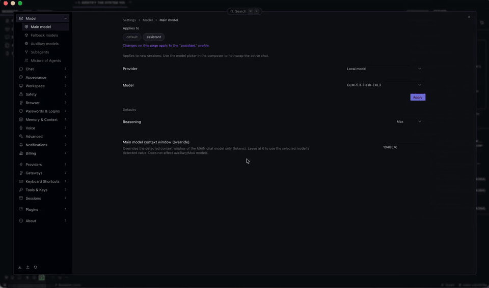

# Hermes Tether

**One Hermes agent, many machines.** Tether lends one remote Hermes agent the local capabilities of your
paired desktop machines (macOS and Windows): their terminal, their files, their screen and apps. The agent
keeps living on its own host; when you say `tether <machine>`, its hands move to that machine, under that
machine's own Hermes rules, until you send `untether` as a message on its own.



## Using it

```text
tether mac      → the Mac asks the person at it to allow this chat; the agent now works on the Mac
… any task …    → terminal, files, apps and screen on the Mac, under the Mac's rules
untether        → back on the host; the Mac empties the session workspace
```

- **Only your own words open a machine:** the message must contain `tether <device>`.
- **`untether` is a solo command:** send it as the whole message. Inside a longer message it does nothing.
- **The person at the machine allows each session** on its own screen. The agent reports a connection
  only after that Allow; No, or no answer within 15 s, means not connected.

## Install

Requires Hermes **0.23.0** or newer on the host and on each machine. Install `tether` on both. For computer
use, also copy `plugin/tether_screen` from the repository into the same `plugins/` folder (it is installed
by hand, not from the catalog) and set `computer_use.backend: tether_screen` on the host. Set
`role: host` on the agent's Hermes and `role: device` on each machine, then pair once: `hermes tether pair
<name>` on the host, `hermes tether join "<link>"` on the device. On a device, Hermes must run in the
signed-in desktop session, since the consent prompt needs a screen.

## Security, disclosure and limits

Pinned, mutual TLS 1.3 link (256-bit suites only) to paired machines; each device dials the host. No
third-party services, no telemetry. Shell commands and file access on a device happen only while tethered,
after its owner allows the session. Background tasks: the link listener (host), the device's connection,
an idle sweeper and a settings watcher. Stored credentials: one Ed25519 key per machine, encrypted at rest,
its passphrase in Hermes's secret store.

Several Hermes Desktops on one backend share it: closing one ends the chat open in the other. Linux devices
are not supported yet (no consent prompt there).

**Full documentation** (setup, configuration, the Tether panel, security model, design decisions):
[README](../../README.md) · [DESIGN](../../DESIGN.md)

---

Author: James Reed. Developed with AI (Claude, Anthropic). MIT licensed.
